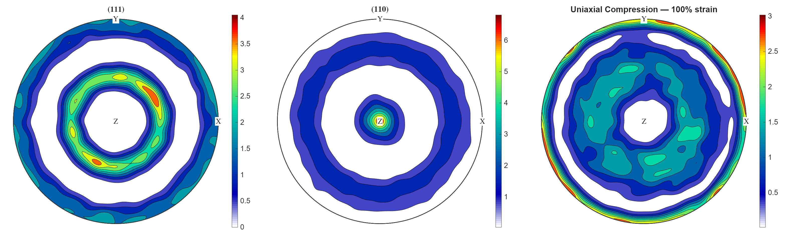
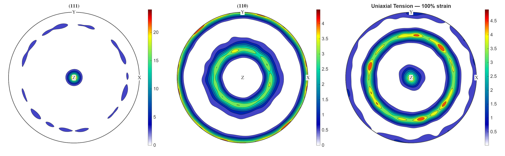
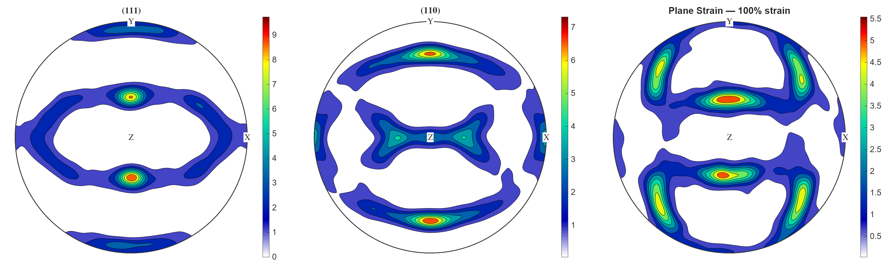
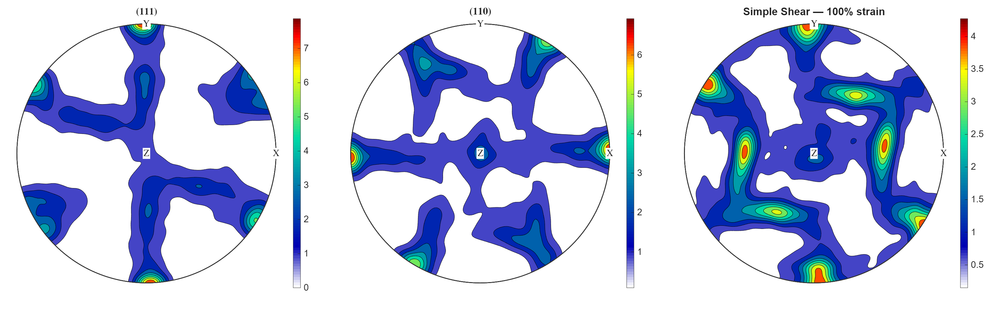
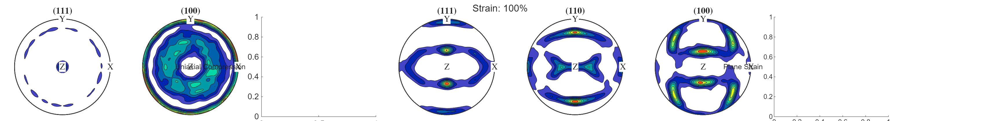

# Crystal Plasticity Grain Model

C++ реализация модели кристаллической пластичности для моделирования деформации и эволюции текстуры поликристаллических материалов.

## Возможности

- Упруговязкопластическая модель для монокристалла (закон Хатчинсона)
- Поддержка произвольного числа систем скольжения
- Два режима ротации кристаллической решётки:
  - **Материальный поворот** (Mandel spin)
  - **Стеснённый поворот Тейлора** (Taylor constrained rotation)
- Представление ориентации через кватернионы
- **RVE** (Representative Volume Element) — осреднение по множеству зёрен
- **Жёсткое и мягкое нагружение** (заданный L или заданный dS/dt)
- **Параллелизация** через OpenMP
- Валидация текстур через MTEX pole figures

## Валидация текстур

Модель прошла валидацию для FCC материала (Cu, Al) — 12 систем скольжения {111}<110>. Полюсные фигуры на 100% деформации совпали с литературными данными:

### Одноосное сжатие (100%)
Текстура `<110>||ND` — классическая для FCC compression:



### Одноосное растяжение (100%)
Текстура `<111>||ND` — классическая для FCC tension:



### Плоское растяжение (100%)
Brass-type текстура `{110}<112>`:



### Простой сдвиг (100%)



### Сравнение всех режимов



## Архитектура

```
┌─────────────────────────────────────────────────────────────┐
│                        MaterialParams                        │
│  (immutable, shared_ptr между зёрнами одного материала)      │
├─────────────────────────────────────────────────────────────┤
│  M[i], Wpm[i], Ms_v[i]  — системы скольжения                 │
│  P_v                    — матрица упругости (6×6)           │
│  tc0, strain_rate_infl  — параметры пластичности             │
│  hard_mode, H, A, q...  — параметры упрочнения               │
│  rot_mode               — режим ротации                     │
└─────────────────────────────────────────────────────────────┘
                              │
                              │ shared_ptr
                              ▼
┌─────────────────────────────────────────────────────────────┐
│                         Grain                                │
├─────────────────────────────────────────────────────────────┤
│  orient_q    — кватернион ориентации (КСК → ЛСК)             │
│  Stress_v    — напряжения в КСК (Фойгт)                      │
│  tc[i]       — критические напряжения (эволюция)             │
│  sp_shifts   — скорости сдвига γ̇^α                          │
└─────────────────────────────────────────────────────────────┘
                              │
                              │ множество зёрен (OpenMP)
                              ▼
┌─────────────────────────────────────────────────────────────┐
│                          RVE                                 │
├─────────────────────────────────────────────────────────────┤
│  stress_av   — средние напряжения                            │
│  W_av        — средний спин                                  │
│  Dp_av       — средняя скорость пласт. деформации            │
│  F_av        — средний градиент деформации                   │
│  acc_strain  — накопленная эквивалентная деформация          │
└─────────────────────────────────────────────────────────────┘
```

## Быстрый старт

### Компиляция

```
Открой EigenProject.sln в Visual Studio 2017
Build → Build Solution (Release x64)
```

Зависимости: **Eigen 3.4+** (путь в проекте: `D:\eigen-3.4.0`)

### Запуск основного проекта

```
EigenProject.exe          # работа с моделью (EigenProject.cpp)
```

### Запуск валидации текстур

`rotation_validation.cpp` компилируется отдельно (не входит в .sln):

```bash
# Из папки проекта:
cl /EHsc /O2 /openmp /I D:\eigen-3.4.0 rotation_validation.cpp Grain.cpp RVE.cpp MaterialParams.cpp

rotation_validation.exe           # генерация текстур (4 режима нагружения)
rotation_validation.exe --tests   # unit-тесты
```

### Построение полюсных фигур (MATLAB + MTEX)

```matlab
cd 'rotation_validation_test_results'
plot_polefigures   # построит PF для всех 4 режимов и сравнение
```

## Формат входного файла материала

```
hard_mode rot_mode
num_slyde_sys
b1_x b1_y b1_z n1_x n1_y n1_z    (система 1: b=направление сдвига, n=нормаль)
...
c11 c12 c44                        (упругие константы, Па)
[если hard_mode==2: A q h0 ts alfa]  (параметры Kocks-Mecking)
tc0                                (начальное критическое напряжение, Па)
strain_rate_infl                   (γ̇_0 для закона Хатчинсона)
n_power                            (степень скоростного упрочнения)
```

### Пример (FCC, grain.txt)

```
2 2
12
0 1 1 1 -1 1
0 1 1 1 1 -1
...
107300000000 60080000000 28300000000
1 2 115e+06 34e+06 2.25
6e+06
1e-2
60
```

## Режимы нагружения

### Жёсткое (Simulate_Step)

Задан градиент скорости `L`:

```cpp
RVE rve("rve_validation.txt");

double eps_dot = 0.1;
Eigen::Matrix3d L = Eigen::Matrix3d::Zero();
L(0,0) =  0.5 * eps_dot;   // поперечное растяжение
L(1,1) =  0.5 * eps_dot;
L(2,2) = -1.0 * eps_dot;   // сжатие вдоль Z

rve.Simulate_Step(dt, L);
```

### Мягкое (Simulate_Step_Soft)

Задана скорость изменения напряжений `dS_dt`:

```cpp
Eigen::Matrix3d dS_dt = Eigen::Matrix3d::Zero();
dS_dt(0,0) = 1e8;  // Па/с

rve.Simulate_Step_Soft(dt, dS_dt);
```

## Структура проекта

```
EigenProject/
├── MaterialParams.h/cpp          — материальные параметры (shared_ptr)
├── Grain.h/cpp                   — класс зерна
├── RVE.h/cpp                     — представительский объём (RVE)
├── EigenProject.cpp              — main() проекта (работа с моделью)
├── grain.txt                     — FCC материал (12 систем {111}<110>)
├── rve_validation.txt            — конфиг RVE (1000 зёрен)
│
├── rotation_validation_test_results/
│   ├── rotation_validation.cpp   — валидация: unit-тесты + текстуры
│   ├── plot_polefigures.m        — MTEX скрипт для полюсных фигур
│   ├── orientations_*.txt        — ориентации на 30/50/100%
│   └── PF_*.png                  — полюсные фигуры
│
├── CONTEXT.md                    — техническая документация
└── README.md                     — этот файл
```

## Теория

### Скорости сдвига (закон Хатчинсона)

```
γ̇^α = γ̇_0 · D_eq · |τ^α / tc^α|^n
```

### Упрочнение Kocks-Mecking (hard_mode=2)

```
H_ii = A · h0 · |1 - tc^i / ts|^α
H_ij = H_ii · q   (i ≠ j)
```

### Ротация решётки

**Материальный поворот (rot_mode=1):** `Ω = W`

**Тейлор (rot_mode=2):** `Ω = W - Wp`, где `Wp = Σ γ̇^α · Wpm^α`

Обновление кватерниона: `q(t+dt) = q(t) · dq(ω·dt)` (умножение справа, ω в КСК)

## Исправленные баги

| # | Баг | Влияние |
|---|---|---|
| 1 | **Wpm: перепутаны индексы** — `W+Wp` вместо `W-Wp` | Неверная ротация, неправильный тип текстуры |
| 2 | Порядок кватернионов `dq*q` вместо `q*dq` | Неверное направление вращения |
| 3 | `sp_shifts` не занулялись при упругом шаге | Мусор в пластическом спине |
| 4 | `check_elastic` не возвращал значение | Undefined behavior |

Подробности в [CONTEXT.md](CONTEXT.md).

## Зависимости

- [Eigen](https://eigen.tuxfamily.org/) 3.4+
- C++14
- OpenMP (опционально)
- MATLAB + MTEX (для валидации текстур)

## Лицензия

MIT License

## Автор

Pavel (OpenSource project)
