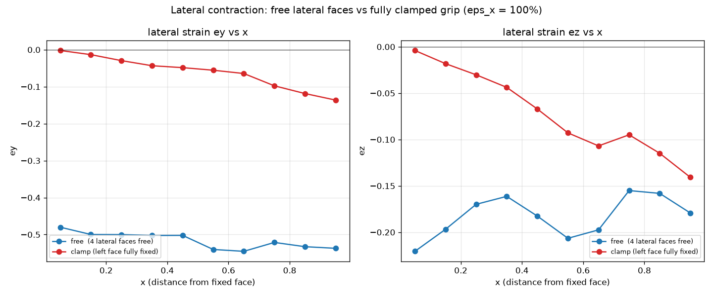

# Example 04 — Neper 200-grain RVE, uniaxial tension

Same 200-grain mesh as [example 03](../03_neper_200grains_symmetry/), but with
proper uniaxial-tension BCs: one face pulled, the opposite face **fixed**, the
other four faces **free** — the specimen may contract laterally.

Two BC variants are provided so the effect of the grip can be compared.

## A. `free` — 4 lateral faces free  (`model.inp`)

```
LEFT   (x=0)  ux = 0            <- held face (slides in y,z)
node 514 (0,0,0)   uy = uz = 0  <- remove y,z translation
node 195 (0,1,0)   uz = 0       <- remove rotation about x
RIGHT  (x=L)  ux = 1.0          <- pulled face
(faces y=0, y=L, z=0, z=L: FREE)
```

`ux=0` on the whole LEFT face removes x-translation and rotations about y,z.
The remaining three rigid-body modes are removed by a minimal 3-2-1 set.
Nothing else is constrained, so the four lateral faces are free.

**Result:** lateral contraction is essentially **uniform** along the specimen
(`ey ≈ -0.50`, `ez ≈ -0.19` at every x). This is expected — with free lateral
faces there is no mechanism for localisation (no geometric softening, no
material softening).

## B. `clamp` — LEFT face fully fixed  (`model_clamp.inp`)

```
LEFT   (x=0)  ux = uy = uz = 0  <- clamped grip (all 3 DOF)
RIGHT  (x=L)  ux = 1.0
```

**Result:** lateral contraction is **non-uniform**: `ey = 0` at the grip and
grows with distance (`≈ -0.13` near the far end). The clamped end cannot
contract, which produces the gradient.

## Comparison



Both cases are volumetrically correct (`J_mean = 1.0002` and `1.0003`) — the
material is plastically incompressible, no artificial dilatancy.

The `J = 1.28` you get from an affine (least-squares) fit of the displaced
nodes is an **artifact**: it fits a single average gradient to a strongly
non-uniform field. Check volume locally from `LE` instead
(`../../scripts/check_volume.py`).

## Generate the decks
```bash
cd ../..
python scripts/neper2abaqus.py meshes/neper_200gr_11135el \
       examples/04_neper_200grains_free/model.inp \
       1.0 0.0001 0.001 mesh_c free
python scripts/neper2abaqus.py meshes/neper_200gr_11135el \
       examples/04_neper_200grains_free/model_clamp.inp \
       1.0 0.0001 0.001 mesh_c clamp
```
Last argument: `sym` | `free` | `clamp`.

## Run
```bash
run.bat            # runs model.inp (free)
```
For the clamped variant:
```bash
abaqus job=model_clamp user=..\..\cp_umat\cp_umat.obj cpus=4 mp_mode=threads standard_parallel=all int
```

## Extract the displacement fields / rebuild the comparison
```bash
abaqus python ../../scripts/extract_u.py model       u_free.txt
abaqus python ../../scripts/extract_u.py model_clamp u_clamp.txt
python compare_bc.py
```

## Notes
- Everything else (mesh, material, `*UNSYMM=YES`, line search, output) matches
  example 03, so runs are directly comparable.
- See example 03's README for the UMAT build and `neper2abaqus.py` details.
